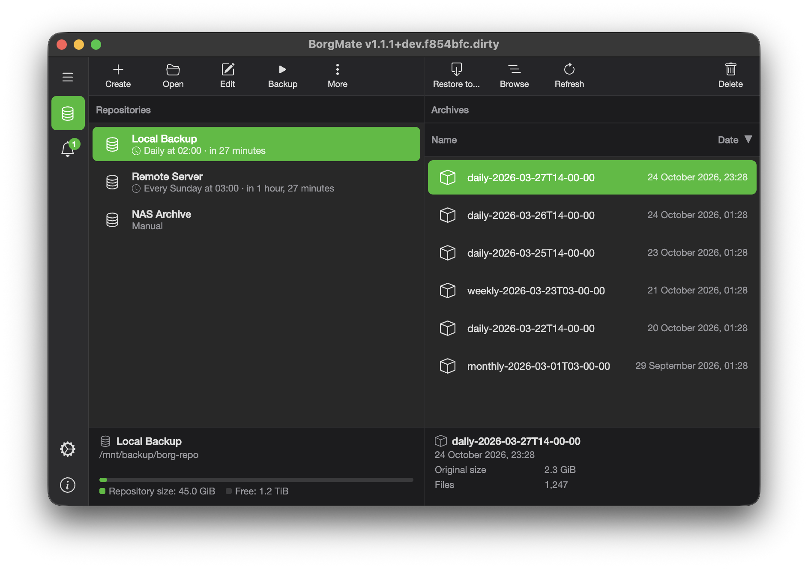

  
  <h1 align="center">BorgMate</h1>
  
A cross-platform desktop GUI for <a href="https://www.borgbackup.org/">BorgBackup</a> 1.4 (and 2, experimental), built with .NET 10 and <a href="https://avaloniaui.net/">Avalonia UI</a> 12

  

## Features

- Manage Borg repositories on local disks, SSH servers, and SMB shares, plus raw Borg 2 URLs such as `sftp://`, `rest://`, `rclone:`, `s3:`, and `b2:`
- Experimental support for Borg 2.0.0b21+ repositories alongside Borg 1.4.x
- Create and schedule backups with real-time progress, speed, and ETA, optional system wake, and AC-power-only runs
- Browse, compare, restore, and delete archives
- Repository maintenance (check, compact)
- Secure passphrase storage via OS keychain (macOS Keychain, libsecret, Windows Credential Manager)
- SSH key passphrase support
- Automatic retry on transient SSH errors and stale repository locks
- Operation journal with history and OS notifications
- System tray with start at login, start minimized, and background scheduling

## Requirements

- [.NET 10 SDK](https://dotnet.microsoft.com/download) (for building)
- [BorgBackup 1.4.x](https://www.borgbackup.org/releases/) (Borg 2.0.0b21+ optional, for experimental Borg 2 repositories — requires a separate `borg2` binary on PATH or a custom path set in Settings)
- [OpenSSH](https://www.openssh.com/) (for remote repositories)
- **Windows:** [WSL](https://learn.microsoft.com/en-us/windows/wsl/install) with borg installed inside it

## Supported Platforms

| Platform       | Architecture |
|----------------|-------------|
| macOS          | x64, arm64  |
| Linux          | x64, arm64  |
| Windows (WSL)  | x64, arm64  |

## Versioning

BorgMate release numbers follow [Semantic Versioning 2.0.0](https://semver.org/).

## License

Licensed under the [GNU General Public License v3.0](COPYING). A commercial license is available for proprietary use cases — contact contact@oddbit.io for details.
