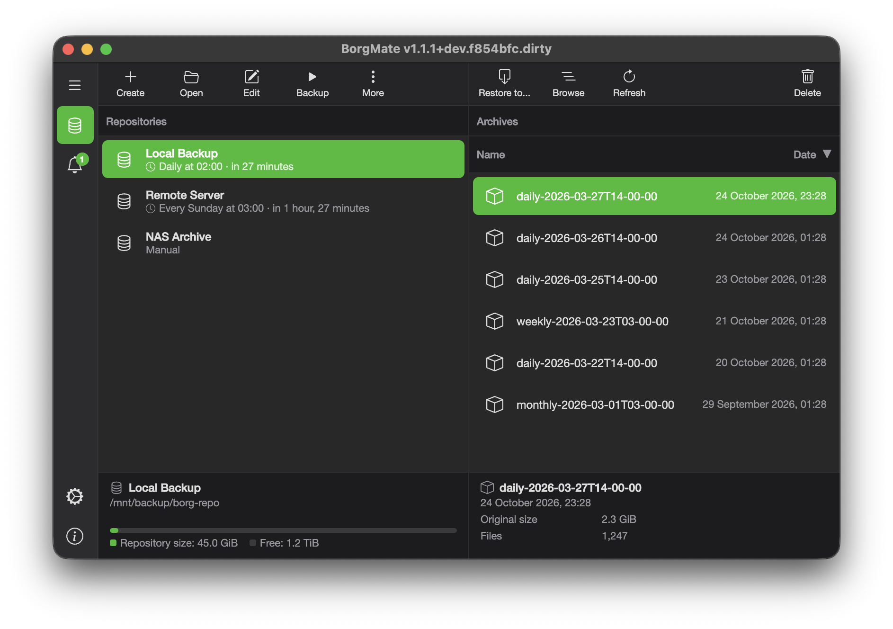

<p align="center">
  
  <h1 align="center">BorgMate</h1>
  <p align="center">A cross-platform desktop GUI for <a href="https://www.borgbackup.org/">BorgBackup</a> 1.4, built with .NET 10 and <a href="https://avaloniaui.net/">Avalonia UI</a> 12</p>
</p>

<p align="center">
  
</p>

## Features

### Backup and restore

- Local disk, SSH, and SMB repositories
- Backup scheduling
- Real-time backup progress, speed, and ETA
- File and folder exclusions
- iCloud placeholder skipping on macOS, without downloading the files
- Archive browsing and comparison
- Upload bandwidth limit for remote repositories
- Secure passphrase storage via OS keychain (macOS Keychain, libsecret, Windows Credential Manager)
- SSH key passphrase support
- Automatic retry on transient SSH errors and stale repository locks
- Parallel operations on different repositories

### Maintenance

- Archive pruning with per-rule retention, optionally after each scheduled backup
- Repository check and compact, with optional compact after prune
- Repository size and free storage

### Desktop integration

- System wake for scheduled backups
- AC-power-only scheduled backups
- Sleep prevention during long operations
- System tray with start at login, start minimized, and background scheduling
- Operation journal and OS notifications

## Signed downloads and updates

Official BorgMate download packages are signed with GPG, and automatic updates install only releases whose manifest carries that signature; the installed binaries themselves are not signed. The signatures are available in our [GitHub releases](https://github.com/oddbit-io/borgmate/releases). GPG signing key fingerprint: `2D0B01C4BDAAF32BA376AE1E793239019CE4CF26`.

Automatic updates verify each downloaded package against the signed SHA-256 before installation, including packages already cached locally.

## Requirements

- [.NET SDK 10.0.404](https://dotnet.microsoft.com/download/dotnet/10.0) (for building; `global.json` requires exactly this version)
- [BorgBackup 1.4.x](https://www.borgbackup.org/releases/), 1.4.5 or newer recommended
- [OpenSSH](https://www.openssh.com/) (for remote repositories)
- **Windows:** [WSL](https://learn.microsoft.com/en-us/windows/wsl/install) with borg installed inside it

## Supported platforms

| Platform       | Architecture |
|----------------|-------------|
| macOS          | x64, arm64  |
| Linux          | x64, arm64  |
| Windows (WSL)  | x64, arm64  |

## Reproducible builds

A Release build of the same commit produces the same `BorgMate.dll` byte for byte on Windows, macOS and Linux.

To rebuild a release, check out its tag in a clean clone and publish it for the platform you want to compare:

```sh
git clone https://github.com/oddbit-io/borgmate.git
cd borgmate
git checkout v<version>
dotnet publish BorgMate/BorgMate.csproj -c Release -r <rid> --self-contained true -o out
```

Starting with 1.3.1, every file in `out` matches the official build, except `BorgMate.deps.json` and `BorgMate.runtimeconfig.json`: the SDK writes them with the line endings of the build machine.

The installers and update packages are not reproducible yet.

## Versioning

BorgMate release numbers follow [Semantic Versioning 2.0.0](https://semver.org/).

## License

Licensed under the [GNU General Public License v3.0](COPYING).
